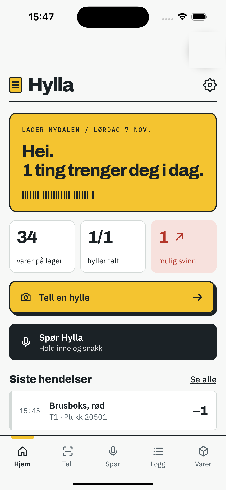

# Hylla

**AI stock-counting assistant for small warehouses and shops.** Built in 45 hours at [Oslo Sprint 2026](https://oslosprint.org/) (6 to 8 Nov 2026, BI Startup Village) for Holio's challenge #7, *stock counting and shrinkage*.



▶️ **Demo film:** [video/hylla-forklaring.mp4](video/hylla-forklaring.mp4) <!-- or a YouTube/Vimeo link -->

## The problem

The system knows what *should* be on the shelf. Nobody knows what actually *is* there until someone counts by hand, and when the numbers differ, nobody knows why.

## What Hylla does

- **Count a shelf from a photo.** A phone or fixed camera counts the items. The code compares the count with the stock log and explains the difference as a delivery, a picked order, or possible shrinkage.
- **Camera that counts by itself.** A phone on a stand watches a shelf and recounts when someone has been there. A change is only booked when two counts in a row agree.
- **Ask Hylla by voice.** Ask in Norwegian and get a spoken answer plus an item card on screen (ElevenLabs).
- **Manager dashboard** (Next.js): overview, items and stock, locations, deviations, event log, and reports with CSV export. Deviations can be sent to staff as tasks.
- **Scanner app for staff** (Expo / React Native): barcode scanning, packing tasks and deviation handling on the floor.

Design principles: the event log is the source of truth (stock is always the sum of events), the AI only counts while plain code does the reasoning, and nothing is saved until a person confirms.

## Team

 Hashem Sheikh ([@HashimS03](https://github.com/HashimS03)), Ho Daniel ([@hodaniel03](https://github.com/hodaniel03), camera counting), Muhayudin "Mayo" Awan ([@muhayudinawan](https://github.com/muhayudinawan), scanner app and security).

Built with heavy use of Claude Code as a pair programmer, which is why many commits are authored by Claude.

## Stack

TypeScript · Next.js 15 / React 19 · Tailwind CSS · Expo (React Native) · Supabase · Claude API (vision counting and tool use) · ElevenLabs (voice) · Meta SAM 3 and YOLO as alternative counters (Python services) · Zod · Vercel

## Run it locally

Everything runs in demo mode without any API keys.

```bash
npm install
cp .env.example .env.local   # optional, see the comments in the file
npm run dev                  # http://localhost:3000
```

Mobile app: `cd mobil && npm install && npx expo start`, then scan the QR code with Expo Go. See [mobil/README.md](mobil/README.md).

## Project layout

```
src/app/     Dashboard pages and API routes
src/lib/     Stock logic, counters (Claude, SAM 3, YOLO, demo), voice tools, storage
mobil/       Expo app for staff
sam3/, yolo/ Optional counting services (Python)
supabase/    Database schema
video/       Explainer film and its source
```

*Norsk versjon med flere detaljer: [docs/README.no.md](docs/README.no.md).*
